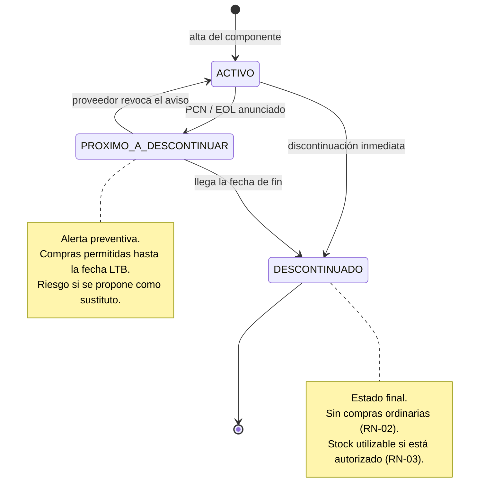
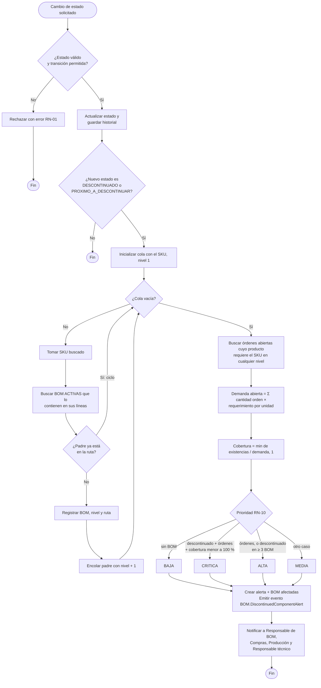
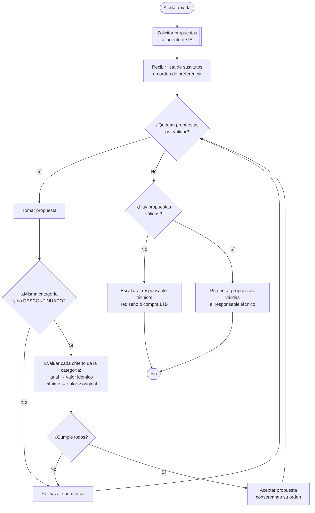
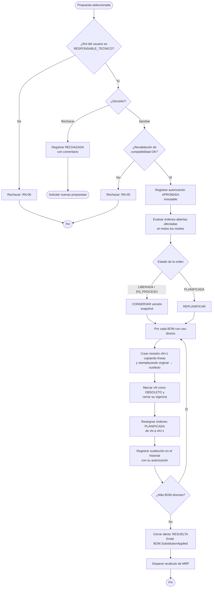
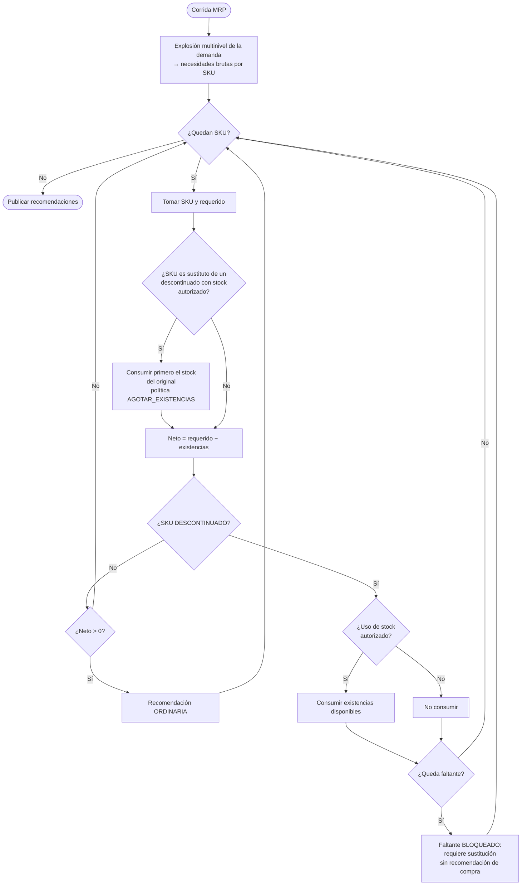

# 4. Diagramas de flujo

Estos diagramas describen la **lógica** de cada etapa: detección, evaluación, autorización y sustitución. Cada uno corresponde a una función de `gestor_descontinuados.py`.

---

## 4.1 Máquina de estados del ciclo de vida (RN-01)

---

## 4.2 Detección y generación de la alerta

Funciones: `ERP.cambiar_estado`, `ERP.boms_afectadas`, `ERP.generar_alerta`, `ERP.priorizar`.

**Ejemplo del escenario:** `MB-B550-PLUS` → 4 BOM (2 de nivel 1 y 2 de nivel 2), 3 órdenes abiertas, demanda de 45, existencias de 12, cobertura de 27 % → prioridad **CRITICA**.

---

## 4.3 Recepción y validación de propuestas de sustitutos

Funciones: `ERP.recibir_propuestas`, `ERP.es_compatible`.

El agente de IA es un sistema externo: recibe la alerta y devuelve sustitutos ordenados y justificados. Cómo los elige lo define el equipo de IA (ver [07 §7.2](07_Requerimientos_para_BD_e_IA.md#72-requerimientos-para-el-equipo-de-inteligencia-artificial)). Este flujo muestra lo que hace el ERP con esa respuesta.

**Resultado en el escenario** (la respuesta del agente está simulada):

| Orden del agente | Propuesta | Validación del ERP (RN-05) |
|---|---|---|
| 1 | `MB-B550-PRO` | Compatible |
| 2 | `MB-X570-ELITE` | Compatible |
| 3 | `MB-B650-AURA` | **Rechazada:** socket AM5 ≠ AM4, memoria DDR5 ≠ DDR4 |

---

## 4.4 Autorización y aplicación de la sustitución

Funciones: `ERP.autorizar`, `ERP.aplicar_sustitucion`.

> Las BOM de nivel superior (por ejemplo `PC-OFI-100`) **no se versionan**. Referencian al subensamble `ENS-BASE-AM4` y, al explotarse, toman su revisión vigente (`v2`). Así se evita multiplicar revisiones innecesarias.

Todo el bloque de E a N se ejecuta en **una transacción** (RNF-02): si falla un paso, no se aplica ninguno.

---

## 4.5 Regla del MRP para componentes descontinuados

Función: `ERP.mrp`.

**Escenario (pedido de 30 `PC-OFI-100` + 10 `PC-WS-300`):**

| Momento | `MB-B550-PLUS` | `MB-B550-PRO` | Otras compras |
|---|---|---|---|
| AS-IS | **Compra 28** (inválida) | — | RAM 20, SSD 30, PSU 25 |
| TO-BE, sustitución pendiente | Consume 12; **28 bloqueadas** | — | RAM 20, SSD 30, PSU 25 |
| TO-BE, sustitución aplicada | Consume 12 (agotar existencias) | 28 desde stock (40) → sin compra | RAM 20, SSD 30, PSU 25 |
