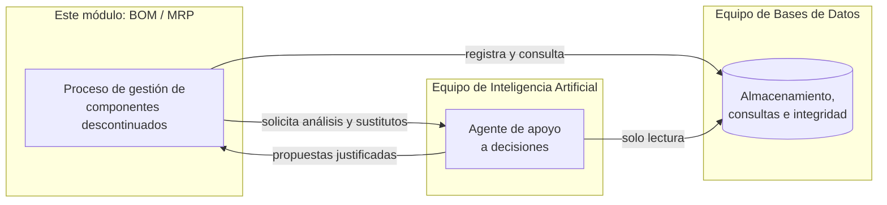

# 7. Requerimientos para los equipos de Bases de Datos e Inteligencia Artificial

## Alcance

Este trabajo cubre el **proceso ERP**: BOM, MRP y su integración con Inventarios, Compras y Producción. El diseño y la implementación de la base de datos y del agente de IA **no forman parte de este alcance**. Corresponden a los equipos de Bases de Datos y de Inteligencia Artificial.

Este documento indica **qué debe hacer cada equipo** para que el proceso funcione: qué información se necesita, qué consultas, qué reglas se deben garantizar y qué debe entregar el agente. Las decisiones de diseño (modelo de datos, tecnología, algoritmos) quedan a cargo de cada equipo.



---

## 7.1 Requerimientos para el equipo de Bases de Datos

### 7.1.1 Información que se debe almacenar

| # | Información | Datos mínimos que necesita el proceso | Usado en |
|---|---|---|---|
| BD-01 | **Estado del ciclo de vida de los componentes** | Estado (`ACTIVO`, `PROXIMO_A_DESCONTINUAR`, `DESCONTINUADO`), fecha de descontinuación, fecha de última compra (LTB), fuente (PCN del proveedor), si se autoriza usar el stock existente, usuario que registró el cambio. Historial de todos los cambios. | CU-01, RN-01, RN-02, RN-03 |
| BD-02 | **Características y especificaciones técnicas** | Categoría del componente y sus atributos técnicos (socket, tipo de memoria, factor de forma, etc.). Criterios de compatibilidad por categoría: qué atributo debe ser igual y cuál debe igualar o superar al original. | RN-05, CU-03, CU-04 |
| BD-03 | **Componentes sustitutos** | Propuestas recibidas del agente de IA: original, sustituto, orden de preferencia, justificación y fecha. | CU-03, CU-04 |
| BD-04 | **Existencias disponibles** | Cantidad disponible y reservada por componente y almacén. | Alerta, RN-03, MRP |
| BD-05 | **Listas de materiales afectadas** | Por cada alerta: BOM afectadas, nivel en que aparece el componente y ruta (por ejemplo `PC-OFI-100 > ENS-BASE-AM4 > MB-B550-PLUS`). | CU-02, KPI 3 |
| BD-06 | **Historial de sustituciones** | BOM anterior y nueva, componente original y sustituto, política (agotar existencias o inmediata), fecha efectiva, usuario y decisión tomada para cada orden de fabricación (conservar o replanificar). | CU-05, CU-06, RN-07, RN-08 |
| BD-07 | **Autorizaciones de cambios** | Propuesta autorizada, usuario, rol, decisión (aprobada o rechazada), comentario y fecha. | CU-04, RN-06 |
| BD-08 | **Alertas** | Componente, fecha de registro de la descontinuación, fecha de la alerta, prioridad, estado, existencias, demanda abierta y fecha de cierre. | CU-02, KPI 1, 2 y 6 |
| BD-09 | **Recomendaciones de compra del MRP** | Corrida, componente, cantidad y tipo (ordinaria o de última compra). | CU-07, KPI 4 |
| BD-10 | **Datos de las órdenes de fabricación** | Además de lo que ya existe: fecha de fin real y causa de retraso. | KPI 5 |

### 7.1.2 Consultas que necesita el proceso

| # | Consulta | Descripción | Usado en |
|---|---|---|---|
| CQ-01 | **Where-used multinivel** | Dado un componente, devolver todas las BOM **activas** que lo contienen directa o indirectamente (a través de subensambles), con nivel y ruta, sin repetir BOM y sin caer en ciclos. | CU-02, KPI 3 |
| CQ-02 | **Órdenes abiertas afectadas** | Órdenes `PLANIFICADA`, `LIBERADA` o `EN_PROCESO` cuyo producto usa el componente en cualquier nivel. | CU-02, CU-05 |
| CQ-03 | **Existencias utilizables** | Disponible − reservado, por componente. | Alerta, MRP |
| CQ-04 | **Especificaciones y criterios** | Especificaciones del original y de los candidatos, junto con los criterios de su categoría, para validar RN-05. | CU-03, CU-04 |
| CQ-05 | **Trazabilidad de una sustitución** | Cadena completa: alerta → propuestas → autorización → sustitución → órdenes evaluadas. | CU-08 |
| CQ-06 | **Datos para KPIs** | Los datos necesarios para calcular los 6 indicadores de [06_KPIs.md](06_KPIs.md). | CU-08 |

### 7.1.3 Reglas que la base de datos debe garantizar

Para que ningún canal de escritura pueda saltarse las reglas críticas, conviene que se apliquen también en la base de datos y no solo en la aplicación:

| Regla | Qué debe impedir la base de datos |
|---|---|
| RN-01 | Que un componente `DESCONTINUADO` vuelva a otro estado. |
| RN-02 | Que se registre una recomendación de compra **ordinaria** de un componente descontinuado. |
| RN-05 / RN-06 | Que se aplique una sustitución sin una autorización **aprobada** por el rol de responsable técnico, o que el sustituto esté descontinuado. |
| RN-08 | Que se modifiquen o borren el historial del ciclo de vida, las autorizaciones o las sustituciones, y que se editen las líneas de una BOM aprobada. |

### 7.1.4 Requerimientos no funcionales

- **Atomicidad.** La aplicación de una sustitución (nueva revisión, cierre de la anterior, historial y reasignación de órdenes) debe ocurrir en una sola transacción.
- **Rendimiento.** La consulta where-used (CQ-01) debe responder en menos de 2 s con 10 000 BOM activas.
- **Fechas.** Todas en UTC, con hora, para poder medir los KPIs de tiempo.
- **Compatibilidad.** Debe extender el esquema BOM existente (`BOM/BD/schema.sql`) en lugar de reemplazarlo.

---

## 7.2 Requerimientos para el equipo de Inteligencia Artificial

### 7.2.1 Decisiones que el agente debe apoyar

Según el issue, el agente debe ayudar a:

| # | Decisión | Qué espera el proceso ERP |
|---|---|---|
| IA-01 | Identificar descontinuados que afectan BOM activas | Confirmar el impacto y resumirlo para los responsables. |
| IA-02 | Identificar riesgos de desabasto | Advertir cuando las existencias no alcanzan para la demanda abierta o cuando se acerca la fecha de última compra. |
| IA-03 | Evaluar y recomendar sustitutos | Proponer sustitutos ordenados por preferencia, cada uno con su justificación. |
| IA-04 | Priorizar alertas según el impacto en producción | Sugerir una prioridad. El ERP asigna una prioridad base con la regla RN-10, que el agente puede refinar. |
| IA-05 | Comparar alternativas | Explicar la comparación en costo, disponibilidad y compatibilidad. |

### 7.2.2 Criterios que debe considerar al recomendar

Los define el issue: compatibilidad técnica, disponibilidad de inventario, disponibilidad con proveedores, costo de adquisición, tiempo de entrega e impacto sobre las listas de materiales. También conviene que considere el **ciclo de vida del candidato**, para no recomendar un componente que pronto también se descontinuará. Cómo se combinan estos criterios (pesos, modelo, técnica) lo decide el equipo de IA.

### 7.2.3 Entrada que proporcionará el ERP

Cuando se genera una alerta, el ERP envía:

```json
{
  "alerta_id": 1,
  "sku_original": "MB-B550-PLUS",
  "categoria": "TARJETA_MADRE",
  "estado": "DESCONTINUADO",
  "especificaciones": {"socket": "AM4", "tipo_memoria": "DDR4", "form_factor": "ATX", "pcie_gen": 4, "ranuras_m2": 2},
  "existencias": 12,
  "demanda_abierta": 45,
  "boms_afectadas": [
    {"bom": "ENS-BASE-AM4 v1", "nivel": 1},
    {"bom": "PC-WS-300 v1", "nivel": 1},
    {"bom": "PC-OFI-100 v1", "nivel": 2},
    {"bom": "PC-GAM-200 v1", "nivel": 2}
  ],
  "ordenes_afectadas": ["OF-1001", "OF-1002", "OF-0990"],
  "prioridad_base": "CRITICA"
}
```

El agente puede consultar en **solo lectura** el catálogo de componentes, las existencias, los proveedores y el historial de sustituciones.

### 7.2.4 Salida que espera el ERP

```json
{
  "alerta_id": 1,
  "prioridad_sugerida": "CRITICA",
  "riesgo_desabasto": "Existencias para 12 de 45 unidades requeridas",
  "propuestas": [
    {"orden": 1, "sku_sustituto": "MB-B550-PRO", "justificacion": "..."},
    {"orden": 2, "sku_sustituto": "MB-X570-ELITE", "justificacion": "..."}
  ],
  "version_modelo": "..."
}
```

El ERP **no recalcula** el orden de las propuestas. Solo vuelve a validar la compatibilidad técnica (RN-05) y rechaza las que no cumplan, como se muestra en el escenario con `MB-B650-AURA`.

### 7.2.5 Restricciones para el agente

| # | Restricción | Motivo |
|---|---|---|
| R-01 | El agente **solo propone**. No cambia estados, BOM ni órdenes. | RN-06 y RN-09: decide una persona. |
| R-02 | Cada propuesta debe incluir su justificación. | El responsable técnico necesita entender la recomendación. |
| R-03 | Se registra la versión del modelo en cada respuesta. | Trazabilidad (RN-08). |
| R-04 | No debe proponer componentes `DESCONTINUADO`. | RN-05 (el ERP también lo valida). |
| R-05 | Debe responder aunque no encuentre un sustituto, indicándolo. | El ERP escala el caso al responsable técnico (CU-03, flujo alterno). |

### 7.2.6 Cómo se evaluará

Para medir al agente se sugiere el porcentaje de alertas en las que el sustituto **aprobado** por el responsable técnico fue la **primera** propuesta. Las autorizaciones rechazadas, con su comentario, son retroalimentación que el equipo de IA puede usar para mejorar el agente.

---

## 7.3 Eventos de integración

Este módulo publica o consume los siguientes eventos. Siguen la convención de `BOM/ERP/events_181914.json` (ISO 8601 UTC, verbos ISA-95):

| Evento | Verbo ISA-95 | Origen → destino | Disparador |
|---|---|---|---|
| `Component.LifecycleChanged` | Change | Compras → BOM | CU-01 |
| `BOM.DiscontinuedComponentAlert` | Notify | BOM → Compras, Producción, agente de IA | CU-02 |
| `BOM.SubstitutionProposals` | Notify | Agente de IA → BOM | CU-03 |
| `BOM.SubstitutionDecision` | Change | Responsable técnico → BOM | CU-04 |
| `BOM.SubstitutionApplied` | Sync | BOM → MRP / MES | CU-06 |
