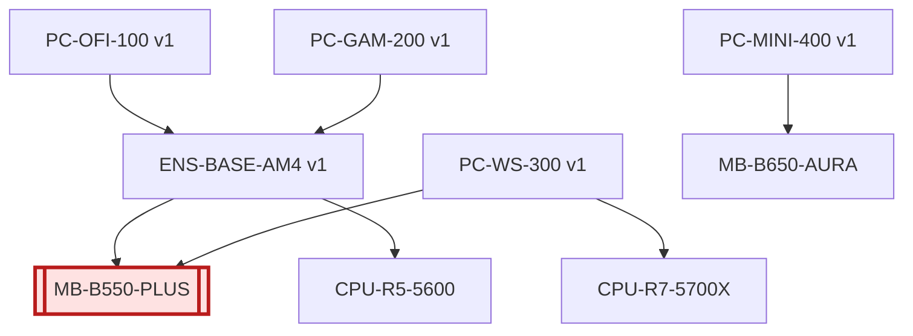

# 8. Escenarios de validación y evidencias

## 8.1 Datos del escenario hipotético

**Componentes (tarjetas madre, categoría `TARJETA_MADRE`):**

| SKU | Socket | Memoria | Factor de forma | PCIe | M.2 | Costo | Entrega | Stock | Estado |
|---|---|---|---|---|---|---|---|---|---|
| `MB-B550-PLUS` | AM4 | DDR4 | ATX | 4 | 2 | 2 300 | 6 d | 12 | Activo → **Descontinuado** |
| `MB-B550-PRO` | AM4 | DDR4 | ATX | 4 | 2 | 2 450 | 5 d | 40 | Activo |
| `MB-X570-ELITE` | AM4 | DDR4 | ATX | 4 | 3 | 3 600 | 7 d | 10 | Activo |
| `MB-B550-LEGACY` | AM4 | DDR4 | ATX | 4 | 2 | 2 200 | 10 d | 60 | Próximo a descontinuar |
| `MB-A520M-LITE` | AM4 | DDR4 | mATX | 3 | 1 | 1 500 | 4 d | 80 | Activo |
| `MB-B650-AURA` | AM5 | DDR5 | ATX | 4 | 2 | 3 100 | 5 d | 25 | Activo |

**Estructura de BOM activas:**



**Órdenes:** OF-1001 (30 × PC-OFI-100, PLANIFICADA), OF-1002 (10 × PC-WS-300, PLANIFICADA), OF-0990 (5 × PC-GAM-200, EN_PROCESO), OF-0950 (8 × PC-MINI-400, PLANIFICADA, no afectada), OF-0900 (TERMINADA).

**Pedido para el MRP:** 30 PC-OFI-100 + 10 PC-WS-300.

## 8.2 Escenarios de validación

Cada escenario indica la regla o el requisito que valida, el resultado esperado, el obtenido y su evidencia automatizada.

| ID | Escenario | Valida | Resultado esperado | Resultado obtenido | Evidencia |
|---|---|---|---|---|---|
| EV-01 | MRP sin gestión del ciclo de vida | Problema P2 (AS-IS) | Recomienda comprar 28 `MB-B550-PLUS` | 28 recomendadas; 25 % inválidas | `test_mrp_as_is_recomienda_comprar_descontinuado` |
| EV-02 | Intentar reactivar un descontinuado | RN-01 | Error de transición | `ErrorDeProceso` | `test_transicion_invalida_desde_descontinuado` |
| EV-03 | Estado de ciclo de vida inexistente | RN-01 | Error | `ErrorDeProceso` | `test_estado_desconocido_rechazado` |
| EV-04 | Registro del cambio de estado | RN-01, RN-08 | Queda en el historial con estado anterior y nuevo | Coincide | `test_cambio_de_estado_queda_en_historial` |
| EV-05 | Descontinuar `MB-B550-PLUS` | RN-04, RF-03 | 4 BOM: 2 de nivel 1 y 2 de nivel 2; PC-MINI-400 no se incluye | Coincide | `test_where_used_multinivel` |
| EV-06 | Prioridad de la alerta | RN-10 | CRITICA (3 órdenes, cobertura 12/45 = 27 %) | CRITICA | `test_alerta_critica_con_ordenes_y_cobertura_insuficiente` |
| EV-07 | Componente sin uso pasa a EOL | RN-10 | Alerta BAJA sin BOM | BAJA | `test_componente_sin_uso_genera_alerta_baja` |
| EV-08 | Propuestas del agente de IA (simuladas) | RN-05, RF-07 | Se aceptan PRO y X570 en el orden del agente; se rechaza B650 | Coincide | `test_erp_valida_compatibilidad_de_propuestas` |
| EV-09 | Propuesta incompatible | RN-05 | Se indican los atributos incumplidos | form_factor, pcie_gen, ranuras_m2 | `test_propuesta_incompatible_indica_motivos` |
| EV-10 | Propuesta de otro componente descontinuado | RN-05 | Rechazada | Rechazada | `test_propuesta_de_otro_descontinuado_rechazada` |
| EV-11 | MRP con la sustitución pendiente | RN-02, RN-03 | Sin compra; consume 12; 28 bloqueadas | Coincide | `test_mrp_no_compra_descontinuado_y_usa_stock` |
| EV-12 | Uso de stock no autorizado | RN-03 | No consume stock; 40 bloqueadas | Coincide | `test_mrp_sin_uso_de_stock_autorizado` |
| EV-13 | Autorización por un rol distinto | RN-06 | Rechazada | `ErrorDeProceso` | `test_solo_responsable_tecnico_autoriza` |
| EV-14 | Aprobar un sustituto incompatible (AM5) | RN-05 | Rechazada | `ErrorDeProceso` | `test_no_se_autoriza_sustituto_incompatible` |
| EV-15 | Aplicar una sustitución rechazada | RN-06 | Rechazada | `ErrorDeProceso` | `test_no_se_aplica_sin_autorizacion_aprobada` |
| EV-16 | Aplicar la sustitución aprobada | RN-07, RN-08 | ENS-BASE-AM4 v2 y PC-WS-300 v2; v1 OBSOLETO sin cambios; OF-0990 se conserva; OF-1001/1002 se replanifican | Coincide | `test_sustitucion_crea_revision_y_conserva_historial` |
| EV-17 | MRP recalculado | RF-12 | Consume 12 PLUS + 28 PRO del stock; sin compras de tarjetas madre | Coincide | `test_escenario_completo_kpis` |
| EV-18 | KPIs del proceso | RF-13 | Detección 0.25 h, sustitución 24 h, 0 % BOM, 0 % inválidas, 0 % órdenes, 100 % de éxito | Coincide | `test_escenario_completo_kpis` |

## 8.3 Evidencias de ejecución

| Archivo | Contenido | Cómo reproducir |
|---|---|---|
| [evidencias/salida_simulacion.txt](evidencias/salida_simulacion.txt) | Recorrido completo AS-IS → TO-BE: alerta, BOM afectadas, validación de propuestas, MRP bloqueado, autorización, sustitución, MRP final y KPIs | `python BOM/Descontinuados_181914/gestor_descontinuados.py` |
| [evidencias/salida_pytest.txt](evidencias/salida_pytest.txt) | 17 pruebas unitarias aprobadas | `pytest tests/test_descontinuados_181914.py` |

### Extracto: salida de la simulación

```text
=== TO-BE: alerta generada ===
  Componente MB-B550-PLUS | prioridad CRITICA | existencias 12 | demanda abierta 45 | cobertura 27%
  BOM afectada nivel 1: ENS-BASE-AM4-v1  ruta ENS-BASE-AM4 > MB-B550-PLUS
  BOM afectada nivel 1: PC-WS-300-v1     ruta PC-WS-300 > MB-B550-PLUS
  BOM afectada nivel 2: PC-OFI-100-v1    ruta PC-OFI-100 > ENS-BASE-AM4 > MB-B550-PLUS
  BOM afectada nivel 2: PC-GAM-200-v1    ruta PC-GAM-200 > ENS-BASE-AM4 > MB-B550-PLUS

=== Propuestas del agente de IA validadas por el ERP (RN-05) ===
  1. MB-B550-PRO     compatible
  2. MB-X570-ELITE   compatible
  Rechazada MB-B650-AURA    socket: AM5 != AM4; tipo_memoria: DDR5 != DDR4

=== MRP mientras la sustitución está pendiente ===
  Consumo autorizado de stock: {'MB-B550-PLUS': 12}
  Faltantes bloqueados (sin compra): {'MB-B550-PLUS': 28}
```

## 8.4 Limitaciones

- El escenario es **hipotético**: costos, existencias y tiempos son ilustrativos y no provienen de una empresa real.
- Los valores AS-IS de los KPIs 1 y 2 son estimaciones, porque el proceso actual no deja registros que permitan medirlos.
- La simulación guarda los datos en memoria. La base de datos real y el agente de IA los implementan sus equipos, según los requerimientos de [07](07_Requerimientos_para_BD_e_IA.md). La respuesta del agente está simulada con una lista fija de propuestas.
